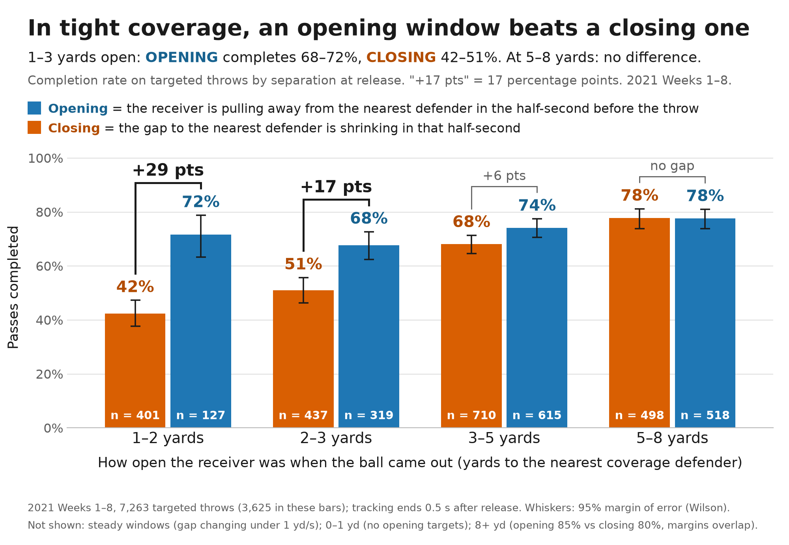
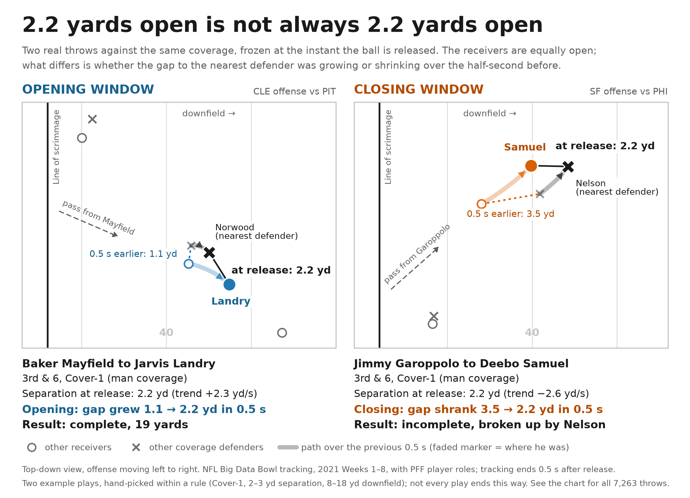

# Window Trend

**The big idea:** when the quarterback lets go of the ball, is the receiver getting *more* open or *less* open? Same 2–3 yards of space, and the pass is caught **68%** of the time if his defender is falling behind, **51%** if the defender is closing in.



**Why we went this way:** separation is always reported as one snapshot. In the tracking data, receivers with the same separation kept getting very different results, and the difference was which way the gap was moving. That direction at the moment of the throw is not a publicly available stat.

**How it helps:** it shows what kind of throws wide receivers, tight ends and running backs are actually being given, so their catch rates and yards after the catch can be judged fairly.

**Who would use it:** a **scout** comparing receivers, a **coach** timing throws and checking which coverages close on his players, and a **broadcaster** who wants one arrow on a replay.

**Open the tool:** [plain-English front page](docs/index.html) · [team and coverage explorer](docs/team-explorer.html)

## What it shows about receivers, tight ends and running backs

- **Wide receivers:** the effect is strongest out wide. In tight coverage (1–3 yards of space), 72% caught on opening windows, 43% on closing ones.
- **Tight ends:** a closing window erases the value of the target (expected points per target +0.52 opening, 0.00 closing).
- **Running backs:** 48% of their targets arrive with a defender closing (wide receivers: 30%). An opening window is worth 4 more yards after the catch (9.3 vs 5.1).
- **Players:** Mark Andrews saw an opening window on 43% of his targets; Tee Higgins and DeVonta Smith on 14%.



## The metric

| Name | What it is | Unit |
|---|---|---|
| **Window Trend** | Change in the target's distance to the nearest coverage defender over the 0.5 s before release. Above +1 is *opening*, below −1 is *closing*. | yards per second, per throw |
| **Opening Rate** | Share of a player's, position's or team's targets thrown into an opening window. | percent |
| **Catches Over Expected** | A receiver's catches minus what the league catches on throws with the same space and the same window. | catches |

## About the data

- **What we were given:** player tracking for 8,557 pass plays (2021, Weeks 1–8), plus play, player and PFF role files. The tracking runs from the snap to half a second after the throw. There is no catch and no run after the catch in it.
- **What that meant:** everything is measured at the moment of release, across 7,263 targeted throws. The targeted receiver is not a column, so we read it from the play description (matched on 96% of throws).
- **What we added:** public [nflverse](https://github.com/nflverse/nflverse-data) play-by-play, joined on game and play id, for yards after the catch and expected points.

## Limitations

- Window Trend largely forecasts where separation will be half a second after the throw. We never see the ball arrive.
- The player numbers describe the throws a receiver was **given** over eight weeks (quarterback timing, play design, coverage). They are context for his catch rate, not a grade of how well he gets open: Opening Rate does not repeat from one half of a receiver's games to the other. It is stable for quarterbacks.
- Where it does no better than plain separation: receivers who are already 5+ yards open, and tight ends lined up inline (59% vs 57%).
- These are observational splits, not cause and effect. "Opening" and "closing" use a cut of ±1 yard per second; the result is the same with ±0.5.
- Team samples are 140–280 targets, so team rankings are indicative only.

## Run it

Python 3.12. The raw data is not in this repo.

```bash
git clone https://github.com/ThompsonJamesBliss/nfl-big-data-bowl-regional-event-data bdb-data
```

```bash
curl -L -o external/play_by_play_2021.csv.gz https://github.com/nflverse/nflverse-data/releases/download/pbp/play_by_play_2021.csv.gz
```

```bash
pip install -r requirements.txt
```

```bash
python src/load.py
```

```bash
python src/window_trend.py
```

```bash
python src/skill_positions.py
```

```bash
python src/make_figures.py
```

```bash
python src/build_dashboard.py
```

```bash
python src/build_tool.py
```

`load.py` prints a check table against known counts and stops if any number is off. Every figure and number above is regenerated by these scripts.

Built during the NYU Big Data Bowl build window on November 10, 2026, with Kiro.
